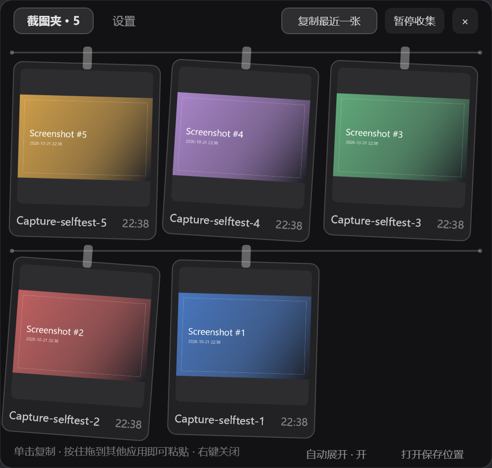
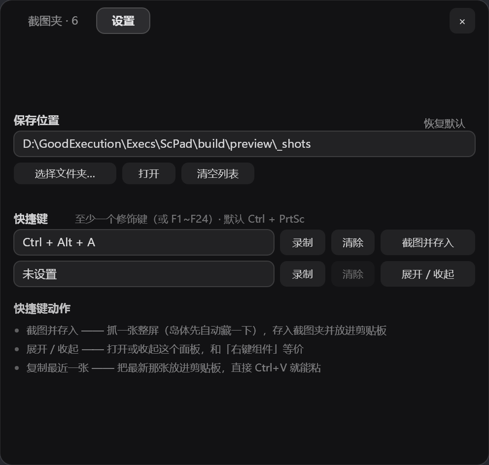
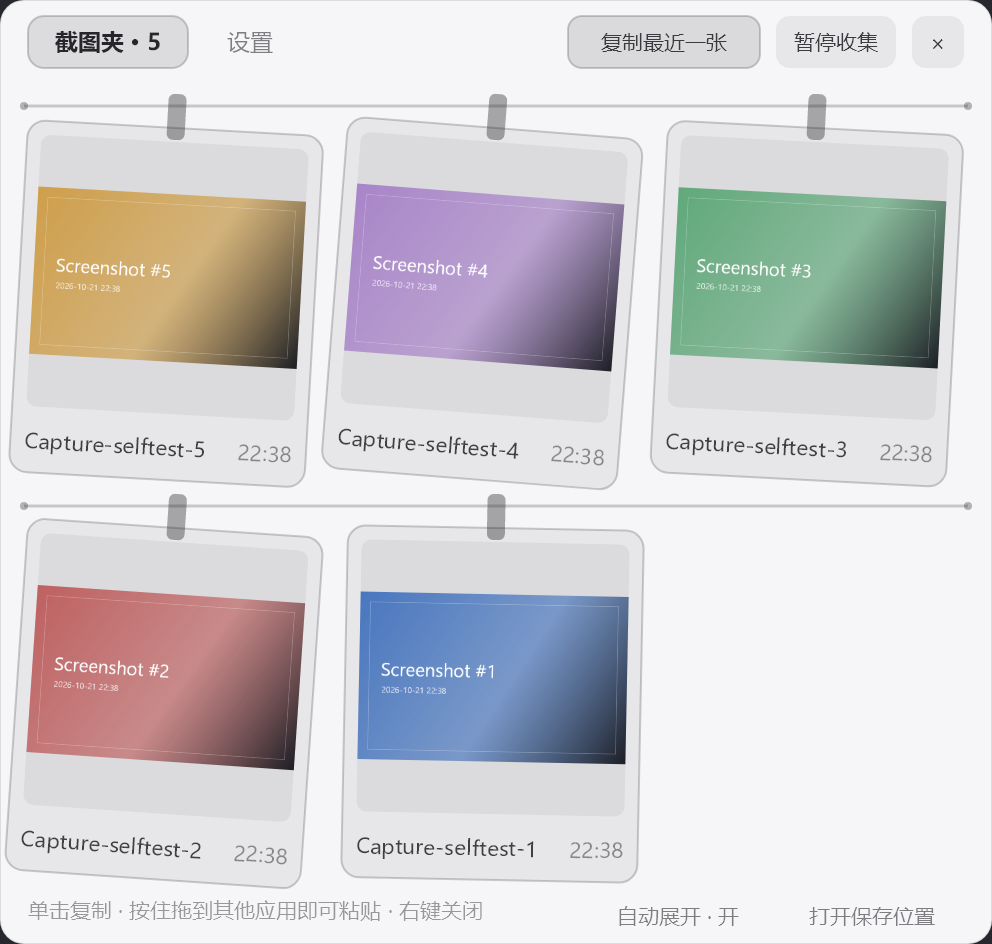
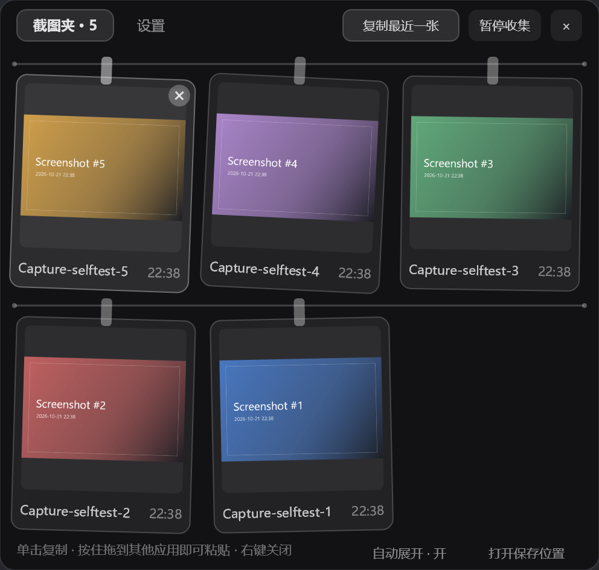
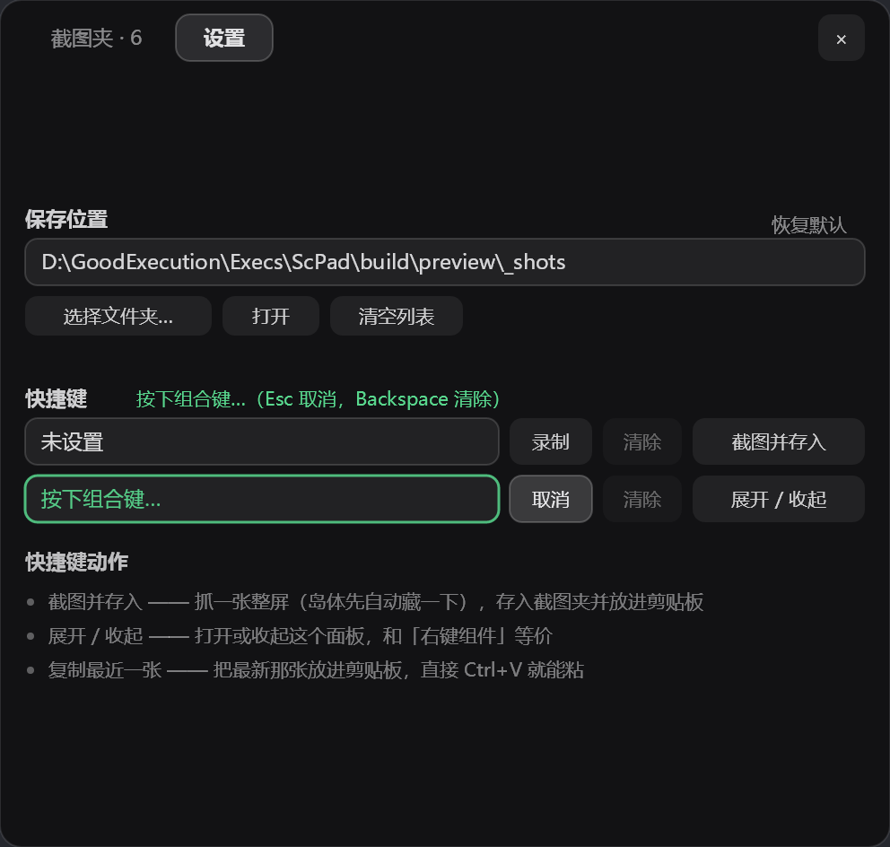

# ScPad · 截屏图片存取（NotchPeninsula 插件）

**ScPad 是为 NotchPeninsula 设计的截屏图片存取插件。**
交互与产品取舍参考了 [jiuyang5354 的 snapline-windows](https://github.com/jiuyang5354/snapline-windows)
（Tendedero 的非官方 Windows 移植；Tendedero 作者 Alejandro Buján），
但**面向 NotchPeninsula 的插件 API 独立实现**，不含、也不再分发上述项目的源代码、图标或图片资源。

作者：**GAHFTSD** · 许可：MIT · 版本：**1.0.0-preview**（预发布）· 插件标识：`com.gahftsd.scpad`

它做的事情很具体：**把截图收进来、挂在灵动岛上、点一下就能复制、按住就能拖到别的应用里粘贴**，
外加一页自己的设置（图片保存位置 + 两个全局快捷键）。

- **不替换、不接管任何原生功能**：媒体控制器、时间日期、硬件占用全都照旧；
- 没有截图时这个组件宽度是 **0**，宿主会把它整个隐藏，岛体宽度一个像素都不变；
- 有截图时也只占 **70~108 逻辑像素**（最近两张缩略图 + 张数），媒体标题再长也轮不到它来抢位置。



| 设置页 | 亮色主题 |
| --- | --- |
|  |  |

> 设置页那张图里把快捷键 1 换成了 `Ctrl + Alt + A` 作示例（默认是 `Ctrl + PrtSc`）。

---

## 一、装进灵动岛

插件目录 = **灵动岛 exe 所在文件夹下的 `plugins`**。

1. 从 [Releases](../../releases) 下载 `ScPad-v1.0.0-preview.zip`，解压得到 `ScPad` 文件夹；
2. **整个文件夹**放进插件目录（目录名就是插件在市场里的标识，别改）：

```
<灵动岛目录>\plugins\ScPad\
    ScPad.dll
    plugin.json
    使用说明.md
    LICENSE
    THIRD-PARTY-NOTICES.txt
```

3. 打开 **设置窗口 → 我的插件**，确认它是「运行中」（第一次加载会弹一条欢迎提醒）；
4. 打开 **设置窗口 → 显示设置 → 显示内容**，把 **ScPad 截图夹** 勾上。

> 从 Snapline 迁过来：ScPad **不会**去读 Snapline 的数据目录。旧截图想继续用，
> 在「设置 → 保存位置 → 选择文件夹…」里指到 `%LocalAppData%\Snapline\Inbox` 即可，
> ScPad 会把它当成普通图片目录监听（不复制、不移动）。

---

## 二、怎么用

### 岛上（收起态）

```
 (轨道) ┌────┐ ┌────┐  ╭───╮
        │缩略│ │缩略│  │ 5 │      ← 最近两张 + 张数胶囊
        └────┘ └────┘  ╰───╯
```

- **点缩略图** = 把那一张复制到剪贴板（随后 `Ctrl + V` 就能粘）；
- **点张数胶囊 / 空白处** = 展开面板；
- **右键** = 展开面板（宿主默认行为）；
- **把图片拖到缩略图上** = 自动展开面板并把图加进去；
- **新截图到手会自动展开面板**（默认开，可在设置页「自动展开」里关掉），这样截完就能直接点/拖；
- 没有截图时它**完全不占位**；只有「已暂停」且一张图都没有时，才会显示一个小小的「已暂停」胶囊。

### 截图夹页



| 操作 | 结果 |
| --- | --- |
| 单击卡片 | 复制这张图（PNG + 位图 + 文件路径三种形态一起进剪贴板） |
| **按住卡片拖到别的应用** | 直接拖出这张 PNG：Word / PPT / 微信 / QQ / 浏览器 / PS 都能接住 |
| 卡片右上角的 **×** | 移出这张（自己收的进 `Recycle` 子目录，外部原图不动） |
| 把文件拖进面板 | 存入列表（图片就行，最多 12 张） |
| **复制最近一张 / 暂停收集 / ×** | 面板右上角的三个按钮 |
| 岛内**右键** | 收起面板 |

> 面板**不会**因为鼠标移开而自动收起（`AutoCollapseDelay` 返回「永不」）。
> 这是必须的：拖出去粘贴时鼠标一定要离开岛体，按默认 0.9 秒收起的话，拖放目标当场就没了。

### 设置页（面板左上角的「设置」页签）



**① 保存位置** —— 图片存哪儿。默认就是**系统默认的截图位置**：
`%USERPROFILE%\Pictures\Screenshots`（当前用户的「图片\屏幕截图」）。
这个路径由 Windows 按**当前登录用户**解析，代码里不写死任何用户名/盘符；
用户在资源管理器里把这个文件夹改到别处（或 OneDrive 重定向）后，这里也跟着变：

- **选择文件夹…** → 系统文件夹选择框（立即生效，之后的截图写进新目录）；
- **打开** → 资源管理器打开当前目录；**恢复默认** → 回到上述系统默认位置；
- **清空列表** → 全移出（自己收的进 `Recycle`，外部原图不动）；
- 目录被删 / 没权限时，路径以警示色显示并写出原因。

**② 快捷键** —— 两格，随时可改：

| 槽位 | 默认 | 默认动作 |
| --- | --- | --- |
| 快捷键 1 | **Ctrl + PrtSc** | 截图并存入（同时进剪贴板，抓完直接 `Ctrl + V`） |
| 快捷键 2 | 未设置（可录成 **Alt + Ctrl + 任意键**） | 展开 / 收起 |

- **录制**：点一下按钮后按组合键（**至少一个修饰键**，或单按 F1~F24）。
  录制期间所有已注册热键会先摘掉，所以可以放心重录当前热键。**Esc** 取消、**Backspace** 清除。
- **清除** 清空该格；**动作** 点一下循环切换 `截图并存入 / 展开·收起 / 复制最近一张`。
- 被别的程序占用时那一格变警示色并写明错误码。

三个动作的差别：

- **截图并存入** —— 抓一张整屏（抓的瞬间把岛体藏 ~140ms，免得照片里多个灵动岛），
  存入列表**同时**放进剪贴板；
- **展开 / 收起** —— 开关面板（等价于右键组件）；
- **复制最近一张** —— 最新那张进剪贴板。

### 收集了什么

1. **剪贴板里的图片**：`Win + Shift + S` 截图、任何程序里 `Ctrl + C` 的图片；
   文字、文件、我们自己刚复制 / 刚抓的图（带 `ScPad.Origin` 标记）都会跳过。
2. **保存目录里新出现的图片**（默认系统「屏幕截图」文件夹）。
3. **拖进来的图片**（面板里，或直接拖到岛上的图标上）。
4. **快捷键 1**（默认 Ctrl + PrtSc）抓的整屏。

同一张图（按像素内容的 SHA-256 判重）不会重复挂两次；最多保留最近 12 张。

---

## 三、数据与设置

| 内容 | 位置 |
| --- | --- |
| **图片本身**（可配置） | 默认 = 系统默认截图位置 `%USERPROFILE%\Pictures\Screenshots`（按 Windows 用户解析、改过位置会跟随）；自己抓的图命名 `ScPad-yyyyMMdd-HHmmss-fff-xxxxxx.png` |
| 列表状态 / 回收站 | `%LocalAppData%\NotchPeninsula\ScPad\`（`state.txt`、`Recycle\`） |
| 开关 / 路径 / 快捷键 | 宿主注册表 `HKCU\SOFTWARE\NotchPeninsula\Plugin.com.gahftsd.scpad.*` |
| 日志 | `%LocalAppData%\NotchPeninsula\app.log`（统一前缀 `[ScPad]`） |

设置键：`saveFolder`、`paused`、`clipboard`、`autoPeek`、`hotkeyA` / `hotkeyAAction`、
`hotkeyB` / `hotkeyBAction`（快捷键存成 `修饰键:虚拟键码`，例如 `2:44` = Ctrl + PrtSc）。

想换插件自己的数据目录（便携 / 多开调试）：设环境变量 `SCPAD_DATA` 指向目标文件夹
（只影响 `state.txt` 与 `Recycle`，不影响图片保存位置）。

---

## 四、生成 dll（构建）

插件最终只需要**一个文件**：`ScPad.dll`。它不打包 SkiaSharp / WinForms，这些由宿主提供。

### 方式一：直接下载（只想用插件的人）

到 [Releases](../../releases) 下载 `ScPad-v1.0.0-preview.zip`，解压出 `ScPad/` 文件夹，
整个丢进灵动岛的插件目录即可：

```
<灵动岛目录>\plugins\ScPad\ScPad.dll
<灵动岛目录>\plugins\ScPad\plugin.json
```

### 方式二：用 .NET SDK 自己编（推荐，最稳）

**前置条件**

| 需要 | 说明 |
| --- | --- |
| .NET SDK **10** | `dotnet --list-sdks` 里要有 `10.x`（插件与宿主都必须是 `net10.0-windows10.0.19041.0`） |
| NotchPeninsula **源码** | 因为插件要引用宿主程序集；本仓库用 `ProjectReference` 指向 `..\NotchPeninsula-main\NotchPeninsula.csproj` |

**目录结构**（关键在于两者同级）：

```
工作目录\
├─ ScPad\                      ← 本仓库
│   ├─ ScPad.csproj
│   └─ ...
└─ NotchPeninsula-main\        ← 宿主源码（解压出来的那一层，含 NotchPeninsula.csproj）
    ├─ NotchPeninsula.csproj
    └─ Plugin\PluginApi.cs
```

**一条命令**

```powershell
dotnet build ScPad.csproj -c Release
```

宿主源码不在默认位置时，用属性覆盖，别去改 csproj：

```powershell
dotnet build ScPad.csproj -c Release -p:NotchPeninsulaProject="D:\src\NotchPeninsula-main\NotchPeninsula.csproj"
```

**产物在哪**

```
ScPad\bin\Release\net10.0-windows10.0.19041.0\ScPad.dll      ← 这个就是要装的插件
..\ScPad-Plugin\                                            ← 顺手生成的「可直接安装」文件夹
    ├─ ScPad.dll
    └─ plugin.json          { "dll": "ScPad.dll" }
```

把 `ScPad.dll` + `plugin.json` 一起放进 `<灵动岛目录>\plugins\ScPad\` 即可（**不要**改名：
插件 Id 与入口文件名在市场里是配对识别的，发布后不能再改）。

**常见编译错误**

| 报错 | 原因 / 处理 |
| --- | --- |
| 找不到 `NotchPeninsula.csproj` | 宿主源码不在同级目录 → 用上面的 `-p:NotchPeninsulaProject=...` |
| `not found: net10.0-windows10.0.19041.0` | 没装 .NET 10 SDK，或只装了运行时 |
| 宿主编译报缺包 | 宿主自己依赖 NuGet 包（SkiaSharp / NAudio / System.Management / ModelSensingProtocol），首次需要联网 `dotnet restore` |

### 方式三：没有 .NET SDK（离线编译，复现发布包用的就是这条路）

```powershell
powershell.exe -NoProfile -ExecutionPolicy Bypass -File .\build\build-offline.ps1
```

用系统自带的 `%windir%\Microsoft.NET\Framework64\v4.0.30319\csc.exe`，对着本机已有的 .NET
**运行时**程序集编译，**不需要 SDK、不需要联网、不需要 NuGet**。原理写在
`build\PluginApiStub.cs` 顶部：把宿主 `Plugin/PluginApi.cs` 里插件用到的那部分类型抄成一个
名为 `NotchPeninsula.dll` 的「签名替身」当编译引用 —— 替身只在编译时存在（不发布、不会被加载），
插件 dll 里留下的是"按名字+签名"的引用，运行时由真正的 `NotchPeninsula.exe` 兑现。

> ⚠️ `build\PluginApiStub.cs` 里的每个声明都必须和真宿主签名逐字一致；宿主升级后请同步。
> 有 SDK 的机器优先走方式二。

### 自检（不需要装进灵动岛）

```powershell
powershell.exe -NoProfile -ExecutionPolicy Bypass -File .\build\run-selftest.ps1
```

用假宿主把插件真的跑起来，**49 项检查**：组件宽度 / 面板尺寸 / 页签切换、保存位置默认值与
改目录后新图真的落进新目录、默认保存位置确实按当前用户解析、自动展开默认开启、
快捷键默认值与**真·系统注册**（被别的进程占用时按 1409 跳过）、
清除 / 录制 / 动作切换、剪贴板采集、整屏抓图（含"抓完进剪贴板"）、单击复制、按住拖出、
× 移出并进回收、暂停、重启后恢复列表与设置；顺带把两页的预览图渲染到 `build\preview\`。

### 和真宿主的接口对账

`build\metadump\MetaDump.cs` 是个元数据比对小工具（用 `System.Reflection.Metadata`，不加载程序集）：

```
dotnet exec MetaDump.dll out.tsv 本插件.dll <市场里的其它插件>.dll ...
```

把本插件和已装的市场插件（OneSaying / FileStation / NpsIslandTuner / NpsSettingsHub / NtfyIsland）
的清单对着看：凡是两边都调用的宿主成员（`GetSetting` / `SetSetting` / `RegisterWidget` /
`CloseDetailPage` / `ToggleDetailPage` / `InvalidateWidgetLayout` / `StartFileDrag` /
`WidgetHit..ctor` / `ReminderData..ctor` / `Logger.*` / `NotchWindow.InstanceHandle` …），
签名完全一致 —— 这是"这个 dll 能被真宿主接住"最硬的证据。

顺带一个发现（也是本插件用反射写 `ReminderData` 的原因）：市场插件里 `ReminderData::set_Title`
的签名是 `20 01 1F xx 01 0E`，那个 `1F` 就是 `modreq(IsExternalInit)`；C# 5 编译器写不出这个
modreq，用对象初始化器赋值会在运行期 `MissingMethodException`，走 `GetSetMethod(true).Invoke` 才稳。

---

## 五、实现结构

```
ScPad.csproj                  工程（ProjectReference 指向宿主）
AssemblyInfo.cs               程序集信息（关掉自动生成；InternalsVisibleTo 给自检台）
ScPadPlugin.cs                入口类：INotchPlugin，装配下面这些东西
Settings.cs                   PluginSettings（保存位置 / 开关 / 两个快捷键）+ HotkeySpec（格式化与校验）
HotkeyHost.cs                 全局快捷键线程：RegisterHotKey + WM_HOTKEY + 录制
ScreenCapture.cs              整屏抓图（抓之前把岛体藏 ~140ms）
ShotStore.cs                  截图仓库：保存目录、落盘、判重、缩略图、不可变快照、state.txt
CaptureService.cs             STA 后台线程：剪贴板轮询 + 目录监听 + 任务队列（复制/抓屏/选目录…）
ClipboardOps.cs               剪贴板读写（PNG / 位图 / 文件路径三种形态）
ScPadWidget.cs                岛上组件（IWidget）：缩略图 + 张数胶囊
ShotClipPanel.cs           面板（IDetailPage）：截图夹页 + 设置页
Ui.cs                         绘制小工具（字体现取现用、画笔临时创建、路径尾部省略）
Reminders.cs                  提醒投递（init 属性走反射）
Log.cs                        宿主日志薄封装
build\                        离线编译替身 + 自检台 + 元数据比对（不参与插件编译）
```

几个关键取舍：

- **三条线程，各管一件事**。渲染线程（宿主）只画；采集线程（STA，插件自建）管剪贴板、
  文件监听、抓屏、文件夹选择框；快捷键线程（插件自建）管 `RegisterHotKey` 与录制。
  三者之间只有 `ConcurrentQueue<Action>`、`Interlocked`/`volatile` 字段与不可变快照。

- **快捷键为什么自带消息循环**：`RegisterHotKey(IntPtr.Zero, ...)` 在 hWnd 为 NULL 时把
  `WM_HOTKEY` 投递到调用线程的消息队列，连窗口都不用建 —— 一条线程 + `PeekMessage` 就够。
  录制时先把所有热键注销（否则重录当前热键会被自己吞掉），再用 `GetAsyncKeyState` 轮询
  "下一个按下的非修饰键"，用 `GetKeyNameText` 翻名字（`PrtSc` 要特判：扫描码 0x37 + 扩展位，
  名字是 "Prnt Scrn"）。

- **不可变快照**。渲染线程只读 `ShotStore.Snapshot`；每次变更整体换一个新数组
  （`Volatile.Write`），老的位图从不显式 `Dispose`（交给终结器），不存在 use-after-free。

- **字体现取现用、画笔临时创建**。不缓存 `SKTypeface`，每帧 `new SKPaint` 用完 `using` 释放；
  颜色全部从 `frame.Theme.TextColor` 派生。订阅 `FontConfig.Changed` 后调
  `host.InvalidateWidgetLayout()` 重测宽度。

- **面板两页共用一个尺寸**。`MeasureWidth/Height` 只在展开时算一次，切页签不重新测量；
  设置页内容在需要时整体垂直居中。

- **拖出用宿主 `StartFileDrag`**（文档第 14 条：详情页没有自己的窗口，必须由宿主代为发起）。
  在 `OnMouseMove` 里按 4px 阈值触发；拖放期间 `OnMouseUp` 不会来，「正在拖动」在 `finally` 复位。

- **抓屏时藏岛体**：`NotchWindow.InstanceHandle` 是宿主公开的岛体句柄，抓图前
  `SetWindowPos(...SWP_HIDEWINDOW)`、抓完在 `finally` 里 `SWP_SHOWWINDOW`；拿不到句柄时照常抓。

---

## 六、与参考实现（Snapline）的差异

| Snapline | ScPad |
| --- | --- |
| 屏幕顶部一条独立 WPF 窗口 | 灵动岛组件 + 右键展开的面板（不额外开窗口、不抢焦点） |
| 快捷键默认 Ctrl + Alt + T | 两格可自定义（默认 Ctrl + PrtSc = 截图并存入），动作三选一 |
| WPF 设置窗口（四页） | 面板里的设置页（保存位置 / 快捷键 / 动作）—— 宿主没有给插件的设置页接口 |
| 多显示器、全屏应用检测 | 交给灵动岛自己的自动隐藏 / 全屏策略 |
| 双击预览、长按画图编辑、右键菜单 | 单击复制、× 移出、打开保存位置；其它交给系统 |
| 拖出携带"图片 + PNG + FileDrop" | 拖出携带 PNG 文件路径（宿主 API 的形态）；图片形态用单击复制 |
| 更新检查、开机启动、透明度 / 主题 | 不做（宿主统一管外观与更新） |
| 数据在 `%LOCALAPPDATA%\Snapline` | 数据在 `%LOCALAPPDATA%\NotchPeninsula\ScPad`，与 Snapline 完全不共享 |
| 12 张、判重、暂停收集、文件夹监听 | 保留 |

---

## 七、排错

1. 「我的插件」里显示加载失败 → 看 `%LocalAppData%\NotchPeninsula\app.log` 的 `[ScPad]` 行；
   多数是宿主版本与插件 API 不匹配（用路线 A 重新编译一份）。
2. 岛上看不到 → 确认「显示内容」勾了 **ScPad 截图夹**，且至少有一张截图（没有截图时宽度为 0，是设计意图）。
3. 快捷键没反应 → 设置页里那一格若是警示色，说明注册失败（被别的程序占用），换一个组合；
   `Alt + Ctrl + 字母` 这类组合通常很空。
4. 复制没反应 → 剪贴板可能被别的程序占着（插件会重试 5 次并弹提醒）。
5. 拖不出去 → 宿主是单线程渲染，拖放期间岛体会短暂"卡住"，属 OLE 拖放循环的正常表现。
6. 抓屏时岛体闪了一下 → 那是刻意藏了 ~140ms，这样照片里才没有灵动岛。

---

## 八、许可与署名

ScPad 以 **MIT** 许可发布，全文见 [`LICENSE`](LICENSE)。

它在交互与产品取舍上参考了下面两个项目，因此**主动**保留署名（全文见
[`THIRD-PARTY-NOTICES.txt`](THIRD-PARTY-NOTICES.txt)）：

| 项目 | 作者 | 关系 |
| --- | --- | --- |
| [Snapline · Windows 版](https://github.com/jiuyang5354/snapline-windows) | jiuyang5354 | 主要参考（参考版本 **v1.3.0**） |
| [Tendedero](https://github.com/alejandrobujan/tendedero) | Alejandro Buján | 交互概念的源头（Snapline 的上游） |

三点说明：

1. **独立实现**：C# 重写、面向 NotchPeninsula 的插件 API（.NET 10 + SkiaSharp，无 WPF），
   **未包含、未再分发**上述项目的源代码、图标或图片；界面元素全部由代码绘制。
2. **独立的名称与标识**：`ScPad` / `com.gahftsd.scpad` / `ScPad.dll`，不使用对方的名称、
   图标或插件标识，也不暗示与它们同源或获其背书。
3. **不耦合数据**：不读取、不写入 `%LOCALAPPDATA%\Snapline`；不复用其设置、剪贴板标记与文件名约定。

### 发布清单（v1.0.0-preview）

- [x] 插件名 / Id / 入口文件名都是中性的（`ScPad` / `com.gahftsd.scpad` / `ScPad.dll`）；
- [x] `LICENSE`、`THIRD-PARTY-NOTICES.txt` 填好作者（GAHFTSD）并随包分发；
- [x] 版本定为 **1.0.0-preview**（程序集版本只能是数字，信息版本走
      `AssemblyInformationalVersion("1.0.0-preview")`）；
- [x] 49 项自检全过，并与市场里的插件做过宿主接口签名对账；
- [ ] 在 GitHub 建公开仓库并推送（`.gitignore` 已排除编译产物与内部草稿）；
- [ ] 建 Release：tag `v1.0.0-preview`，**勾选 Set as a pre-release**，附上
      `ScPad-v1.0.0-preview.zip`；
- [ ] 邮件告知 jiuyang5354（草稿见 `docs\email-to-upstream.md`，仅本地）；
- [ ] 提交到插件市场（名称 / slug / 简介见 `docs\market-listing.md`，仅本地）；
- [ ] 发布后在真实宿主里完整跑一遍（市场装一次 + 四项功能各验一遍）。

> 逐项要填的字段、要勾的复选框、要替换的占位符，都整理在
> `docs\github-publishing-checklist.md`（本地文件，不进公开仓库）。
