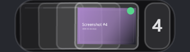
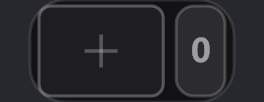
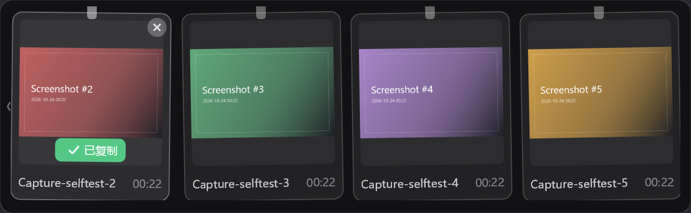
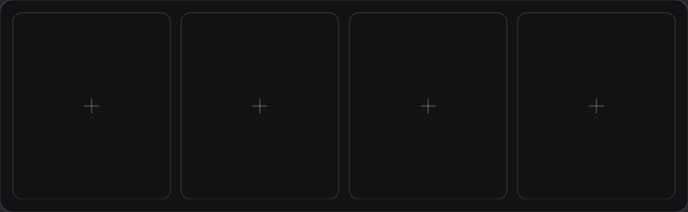
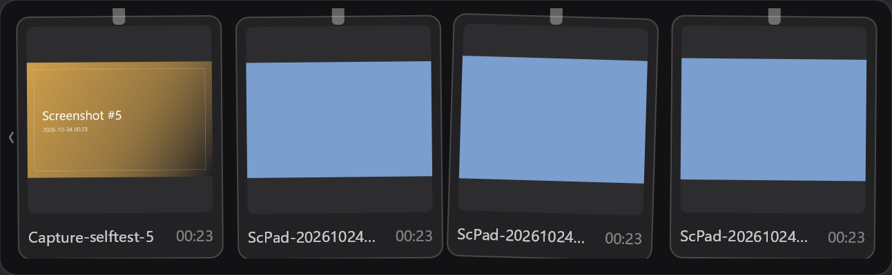
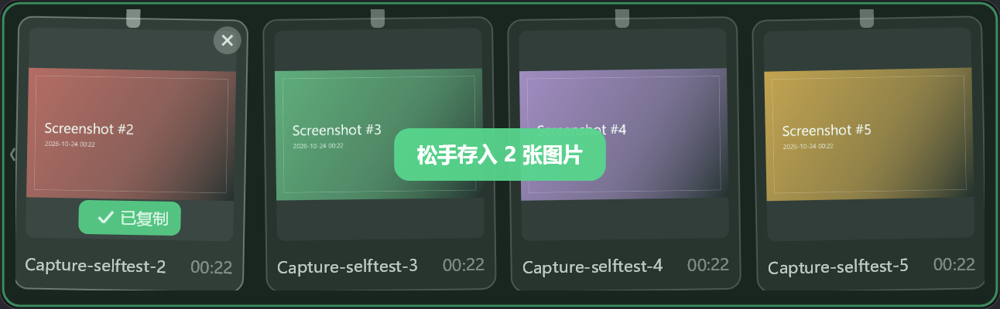

🖼 演示

| 岛上（有图） | 岛上（没图也常驻） |
| --- | --- |
|  |  |

| 截图夹面板 | 复制成功的反馈 |
| --- | --- |
|  |  |

| 空面板（预留 4 格，点 + 从剪贴板上传） | 多图时点两端箭头翻页 |
| --- | --- |
|  |  |

| 把文件拖进面板 | 亮色主题 |
| --- | --- |
|  |  |

> 以上都是自检台用假宿主渲染出来的真实画面，不是设计稿。

✨ 核心内容

🖥 岛上（收起态）

- 右边数字框显示总数，0 也显示；左边是缩略图叠放，没图时用空框铺满。
- 点最上面那张 = 复制到剪贴板；点露出的窄边 = 复制那一张。
- 点数字 / 空框 / 空白 = 展开面板；右键 = 展开面板。
- 叠放是静态的（本版不接管滚轮）；想看更早的请打开面板。
- 把图片拖到这一摞上 = 自动展开面板并收图。
- 新截图到手默认自动展开面板，可在设置里关闭。
- 没有截图时也常驻：空框 + 右边 0。
- 缩略图大小随「截图夹上限」自动缩放，可解锁固定百分比。

📋 截图夹页

操作                        结果
单击卡片                    复制这张图：PNG + 位图 + 文件路径一起进剪贴板
按住卡片拖到别的应用        直接拖出 PNG，Word / PPT / 微信 / QQ / 浏览器 / PS 可接收
卡片右上角 ×                移出这张；自己收的进 Recycle，外部原图不动
把文件拖进面板              收进截图夹；点空槽的 + 可从剪贴板上传
岛内右键                    收起面板；面板无按钮栏、无标题提示文字
点两端 ‹ ›                    超过预留格数时翻页（本版不接管滚轮）

⚙ 设置（官方「插件设置中心」）

面板里没有设置页，岛上只有截图夹本身。所有设置项注入官方插件「插件设置中心」NpsSettingsHub：
岛上齿轮组件 → 左侧插件列表选 ScPad。
没装设置中心不影响插件运行，只是没有统一设置界面。

分组        设置项                         说明
截图夹      截图夹上限（张）               默认 10，可设 4~100，推荐 4~16
            缩略图大小 %                   25~200；不动则跟随上限
            新截图自动展开面板             默认开
            收集剪贴板里的图片             默认开
            暂停收集                       临时不收新截图
            面板预留格数                   1~8，默认 4；空槽也占位
            抓屏时先藏起灵动岛             默认开；抓前淡出约 80ms
保存位置    保存位置（文本）               留空 = %USERPROFILE%\Pictures\Screenshots
            选择文件夹…                     系统文件夹选择框（选完立即生效）
快捷键      快捷键 1 / 2（按钮）            按钮上写着当前组合，点一下即可录制；Esc 取消、Backspace 清除
            快捷键 1 / 2 动作（选择）       截图并存入 / 展开·收起 / 复制最近一张
其它        恢复默认                       只重置设置项，不动保存位置与已收集截图

三个动作的差别：

- 截图并存入：抓一张整屏，抓的瞬间把岛体藏约 140ms，存入截图夹同时放进剪贴板。
- 展开 / 收起：开关面板，等价于右键组件。
- 复制最近一张：最新那张进剪贴板。

📥 收集了什么

1. 剪贴板里的图片：Win + Shift + S 截图、任何程序里 Ctrl + C 的图片；文字、文件、自己刚复制/刚抓的图会跳过。
2. 保存目录里新出现的图片，默认系统「屏幕截图」文件夹。
3. 拖进来的图片：面板里，或直接拖到岛上图标。
4. 快捷键 1（默认 Ctrl + PrtSc）抓的整屏。

同一张图按像素内容 SHA-256 判重，不会重复挂两次；默认保留最近 10 张（4~100 可配，推荐 4~16），超出时最老的移出列表。

🗂 数据与设置

内容                        位置
图片本身（可配置）          默认 %USERPROFILE%\Pictures\Screenshots；自己抓的图命名 ScPad-yyyyMMdd-HHmmss-fff-xxxxxx.png
列表状态 / 回收站           %LocalAppData%\NotchPeninsula\ScPad\（state.txt、Recycle\）
开关 / 路径 / 快捷键        HKCU\SOFTWARE\NotchPeninsula\Plugin.com.gahftsd.scpad.*
日志                        %LocalAppData%\NotchPeninsula\app.log（统一前缀 [ScPad]）

设置键：saveFolder、paused、clipboard、autoPeek、maxShots（4~100，默认 10）、panelSlots（1~8，默认 4）、thumbScale（25~200；0 表示没设过 → 用推荐值）、hideOnCapture、hotkeyA / hotkeyAAction、hotkeyB / hotkeyBAction。
快捷键存成 修饰键:虚拟键码，例如 2:44 = Ctrl + PrtSc。
想换插件自己的数据目录：设环境变量 SCPAD_DATA 指向目标文件夹，只影响 state.txt 与 Recycle，不影响图片保存位置。

🛠 构建与自检

插件最终只需要一个文件：ScPad.dll。它不打包 SkiaSharp / WinForms，这些由宿主提供。

方式一：直接下载

到 Releases 下载 ScPad-v1.0.0-preview-2.zip，解压出 ScPad/ 文件夹，整个丢进灵动岛插件目录：
<灵动岛目录>\plugins\ScPad\ScPad.dll
<灵动岛目录>\plugins\ScPad\plugin.json

方式二：用 .NET SDK 自己编（推荐）

前置条件：
- .NET SDK 10：dotnet --list-sdks 里要有 10.x。
- NotchPeninsula 源码：插件要引用宿主程序集，本仓库用 ProjectReference 指向 ..\NotchPeninsula-main\NotchPeninsula.csproj。

目录结构关键在两者同级：
工作目录\
├─ ScPad\
│   ├─ ScPad.csproj
│   └─ ...
└─ NotchPeninsula-main\
    ├─ NotchPeninsula.csproj
    └─ Plugin\PluginApi.cs

一条命令：
dotnet build ScPad.csproj -c Release

宿主源码不在默认位置：
dotnet build ScPad.csproj -c Release -p:NotchPeninsulaProject="D:\src\NotchPeninsula-main\NotchPeninsula.csproj"

产物：
ScPad\bin\Release\net10.0-windows10.0.19041.0\ScPad.dll
..\ScPad-Plugin\
    ├─ ScPad.dll
    └─ plugin.json          { "dll": "ScPad.dll" }

把 ScPad.dll + plugin.json 一起放进 <灵动岛目录>\plugins\ScPad\。不要改名：插件 Id 与入口文件名在市场里配对识别，发布后不能再改。

常见编译错误：
- 找不到 NotchPeninsula.csproj → 用 -p:NotchPeninsulaProject=... 指定宿主源码。
- not found: net10.0-windows10.0.19041.0 → 没装 .NET 10 SDK，或只装了运行时。
- 宿主编译报缺包 → 宿主依赖 NuGet 包，首次需要联网 dotnet restore。

注意：自定义控件是运行时生成的（DynamicControls.cs），不是源码里的类型。直接写普通 class 继承 SettingControl 会在真宿主里 TypeLoadException。

方式三：没有 .NET SDK（离线编译）

powershell.exe -NoProfile -ExecutionPolicy Bypass -File .\build\build-offline.ps1

用系统自带 csc.exe，对着本机 .NET 运行时程序集编译，不需要 SDK、不需要联网、不需要 NuGet。
原理见 build\PluginApiStub.cs：把宿主 PluginApi.cs 中插件用到的类型抄成名为 NotchPeninsula.dll 的签名替身当编译引用；替身只在编译时存在，不发布、不会被加载。
build\PluginApiStub.cs 里的声明必须和真宿主签名逐字一致；宿主升级后请同步。有 SDK 的机器优先走方式二。

自检（不需要装进灵动岛）：
powershell.exe -NoProfile -ExecutionPolicy Bypass -File .\build\run-selftest.ps1

用假宿主把插件跑起来，97 项检查：组件宽度、面板尺寸、卡片滚动、保存位置默认值与改目录后新图落盘、自动展开默认开启、设置中心控件形态/推荐百分比/按钮轮询/运行时生成控件、常驻状态栏宽度、滚轮惯性与边界、设置变更不自激、预留格数/右到左填充/拖动排序/剪贴板上传/弹簧收敛、快捷键默认值与系统注册、清除/录制/动作切换、剪贴板采集、整屏抓图、单击复制、按住拖出、× 移出并进回收、暂停、重启后恢复列表与设置；顺带把预览图渲染到 build\preview\。

和真宿主的接口对账：
build\metadump\MetaDump.cs 用 System.Reflection.Metadata 比对元数据，不加载程序集。
dotnet exec MetaDump.dll out.tsv 本插件.dll <市场里的其它插件>.dll ...
凡是两边都调用的宿主成员签名一致，就是“这个 dll 能被真宿主接住”的硬证据。
ReminderData 的 init 属性带 modreq(IsExternalInit)，C# 5 编译器写不出，用 GetSetMethod(true).Invoke 更稳。

🧱 实现结构

三条线程，各管一件事：
- 渲染线程（宿主）只画。
- 采集线程（STA，插件自建）管剪贴板、文件监听、抓屏、文件夹选择框。
- 快捷键线程（插件自建）管 RegisterHotKey 与录制。
三者之间只有 ConcurrentQueue<Action>、Interlocked/volatile 字段与不可变快照。

关键取舍：
- 快捷键自带消息循环：RegisterHotKey(IntPtr.Zero, ...) 在 hWnd 为 NULL 时把 WM_HOTKEY 投递到调用线程消息队列，一条线程 + PeekMessage 就够。录制时先注销所有热键，再用 GetAsyncKeyState 轮询下一个按下的非修饰键，用 GetKeyNameText 翻名字。
- 不可变快照：渲染线程只读 ShotStore.Snapshot；每次变更整体换新数组，老位图不显式 Dispose，交给终结器，不存在 use-after-free。
- 字体现取现用、画笔临时创建：不缓存 SKTypeface，每帧 new SKPaint 用完 using 释放；颜色从 frame.Theme.TextColor 派生。订阅 FontConfig.Changed 后调 host.InvalidateWidgetLayout() 重测宽度。
- 面板只有一个尺寸：MeasureWidth/Height 只在展开时算一次，内容垂直居中；卡片数量变化时才重算，避免拖放中面板变形。卡片带单行，一屏最多 4 张，多的点两端箭头翻页。
- 拖出用宿主 StartFileDrag：详情页没有自己的窗口，必须由宿主代为发起。OnMouseMove 按 4px 阈值触发；拖放期间 OnMouseUp 不会来，正在拖动在 finally 复位。
- 抓屏时藏岛体：NotchWindow.InstanceHandle 是宿主公开的岛体句柄，抓图前 SetWindowPos(...SWP_HIDEWINDOW)，抓完 finally 里 SWP_SHOWWINDOW；拿不到句柄时照常抓。

🔁 与参考实现（Snapline）的差异

Snapline                          ScPad
屏幕顶部独立 WPF 窗口             灵动岛组件 + 右键展开面板，不额外开窗口、不抢焦点
快捷键默认 Ctrl + Alt + T         两格可自定义，默认 Ctrl + PrtSc = 截图并存入，动作三选一
WPF 设置窗口（四页）              设置注入官方插件设置中心；岛上无设置页签
多显示器、全屏应用检测            交给灵动岛自己的自动隐藏 / 全屏策略
双击预览、长按画图编辑、右键菜单  单击复制、× 移出、打开保存位置；其它交给系统
拖出携带“图片 + PNG + FileDrop”   拖出携带 PNG 文件路径；图片形态用单击复制
更新检查、开机启动、透明度/主题   不做，宿主统一管外观与更新
数据在 %LOCALAPPDATA%\Snapline    数据在 %LOCALAPPDATA%\NotchPeninsula\ScPad，完全不共享
12 张、判重、暂停收集、文件夹监听 保留

🩺 排错

1. 「我的插件」显示加载失败：看 %LocalAppData%\NotchPeninsula\app.log 的 [ScPad] 行；多数是宿主版本与插件 API 不匹配，用方式二重新编译。
2. 岛上看不到：确认「显示内容」勾了 ScPad 截图夹，且插件运行中；没有截图时常驻 [0] + 空框。
3. 快捷键没反应：设置中心里「快捷键 1」那项会写明注册失败的原因（被别的程序占用），换一个组合；Alt + Ctrl + 字母通常很空。
4. 复制没反应：剪贴板可能被别的程序占着，插件会重试 5 次并弹提醒。
5. 拖不出去：宿主单线程渲染，拖放期间岛体短暂“卡住”属 OLE 拖放循环正常表现。
6. 抓屏时岛体闪了一下：刻意藏了约 140ms，这样照片里没有灵动岛。
7. 设置中心看不到 ScPad：确认插件「运行中」，再在设置窗口点底部「重新扫描」；点进去显示「该插件不在此平台设置」= RegisterSettingsPage 没执行，看日志有没有注册异常。
8. 滚轮在岛上没反应：这是**故意的**（官方要求不接管滚轮）。看更早的截图请打开面板点 ‹ ›。
9. 设置里找不到滚轮相关项：本版已移除；滚轮功能代码保留在仓库里，但默认不启用。

📜 许可与署名

ScPad 以 MIT 许可发布：仓库里有 LICENSE，随包的 使用说明.md 附录 A 也有同一份全文（含第三方署名，附录 B）。

交互与产品取舍参考：
- Snapline · Windows 版：jiuyang5354，主要参考，参考版本 v1.3.0。
- Tendedero：Alejandro Buján，交互概念源头，Snapline 的上游。

说明：
1. 独立实现：C# 重写，面向 NotchPeninsula 插件 API（.NET 10 + SkiaSharp，无 WPF），未包含、未再分发参考项目源代码、图标或图片；界面元素全部由代码绘制。
2. 独立名称与标识：ScPad / com.gahftsd.scpad / ScPad.dll，不使用对方名称、图标或插件标识，也不暗示同源或获其背书。
3. 不耦合数据：不读取、不写入 %LOCALAPPDATA%\Snapline；不复用其设置、剪贴板标记与文件名约定。

📬 联系方式

作者：Airlin Nefeltari Prismriver (GAHFTSD)
B站：https://space.bilibili.com/104341778
邮箱：gahftsd@hotmail.com
项目：本仓库 Releases
GitHub：https://github.com/GAHFTSD
许可：MIT

最后更新：ScPad 1.0.0-preview-2（预发布）

内容部分由 AI 生成